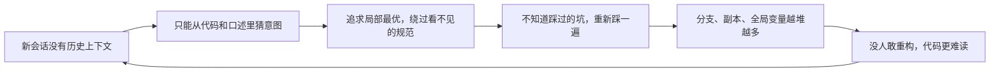
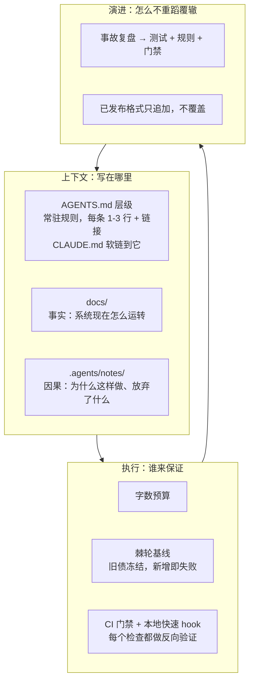

# Sustainable Engineering · 让项目长期维护不崩掉

[](LICENSE)
[](skills/sustainable-engineering/SKILL.md)


一个面向 AI 编程 Agent（Claude Code、Codex、Antigravity 等）和人类开发者的工程治理 Skill：把 [DeepSeek Harness](https://github.com/deepseek-ai/deepseek-harness) 团队维护大型仓库的机制，抽象成任何语言、任何规模都能用的规则、模板和可运行的检查脚本，让项目在人和多个 Agent 长期迭代下不滑向"屎山"。

[English summary](#english-summary)

## 为什么长期项目会崩掉

Vibe coding 让代码越写越快，项目却慢慢变成一次性工程，后面没人敢改。原因是一个自我强化的循环：



靠"更认真地 review"打不破这个循环。只有两件事能打破它：缺失的上下文写进仓库、放在每个会话都会读到的位置；违反规则时由检查直接失败，而不是等一个细心的 reviewer。检查只能管住能机械判断的部分，架构边界和测试强度仍要靠评审和项目自己的门禁。

## 这个 Skill 给你什么



| 支柱 | 解决的问题 | 文档 |
|---|---|---|
| 信息架构与上下文预算 | 规则膨胀、同一事实多处抄写后互相矛盾、Agent 读不完 | [information-architecture.md](skills/sustainable-engineering/references/information-architecture.md) |
| 决策记忆（Agent Notes） | 新会话重新提出早已否决的方案 | [agent-notes.md](skills/sustainable-engineering/references/agent-notes.md) |
| 机械化执行与棘轮 | 规则只写在文档里没人执行；历史债务让新规则无法落地 | [mechanical-enforcement.md](skills/sustainable-engineering/references/mechanical-enforcement.md) |
| 五个防御习惯 | 时序 hack、全局单例、中心 if 树、混在重构里的行为改动、自我汇报式测试 | [defensive-habits.md](skills/sustainable-engineering/references/defensive-habits.md) |
| 演进与事故闭环 | 改坏已发布的数据格式；同类 bug 反复逃逸 | [evolution-and-incidents.md](skills/sustainable-engineering/references/evolution-and-incidents.md) |
| 渐进式落地 | 一上来就全套流程，没人坚持 | [adoption-ladder.md](skills/sustainable-engineering/references/adoption-ladder.md) |
| 评审与健康度审计 | 不知道仓库烂在哪、PR 该看什么 | [review-and-audit.md](skills/sustainable-engineering/references/review-and-audit.md) |

Skill 内置四个工作流：**A** 在新仓库或已经很乱的老仓库里搭建治理；**B** 安全地完成一个非平凡的功能或重构；**C** 评审 PR、审计仓库健康度；**D** 把一次线上事故变成永久护栏。

## 安装

### 通用：skills CLI（推荐）

```sh
npx skills add hewenyu/dsh-osc          # 安装到当前项目
npx skills add hewenyu/dsh-osc -g       # 安装到用户全局
```

[skills CLI](https://github.com/vercel-labs/skills) 会识别本机的 Claude Code、Codex、Antigravity 等 Agent，并放到各自的 skills 目录。

### Claude Code

```text
/plugin marketplace add hewenyu/dsh-osc
/plugin install sustainable-engineering@dsh-osc
```

### Codex 与 Antigravity

```sh
DEST=~/.agents/skills             # Codex 用户全局；Antigravity 用 ~/.gemini/config/skills
( set -e; TMP=$(mktemp -d); trap 'rm -rf "$TMP"' EXIT
  git clone --depth 1 https://github.com/hewenyu/dsh-osc.git "$TMP"
  mkdir -p "$DEST"; cp -R "$TMP/skills/sustainable-engineering" "$DEST/" )
```

- Codex：用户全局 `~/.agents/skills/`，项目内 `.agents/skills/`；旧版本 Codex 读取的 `~/.codex/skills/` 仅作兼容。
- Antigravity：`~/.gemini/config/skills/` 对 App、CLI（`agy`）和 IDE 都生效，项目内同样是 `.agents/skills/`。

### 手动复制

Skill 就是一个目录。把 `skills/sustainable-engineering/` 复制到你的 Agent 读取 skills 的位置即可，例如 Claude Code 的 `~/.claude/skills/`（全局）或项目内 `.claude/skills/`。

## 快速开始

安装后，直接对 Agent 说：

- "用 sustainable-engineering 审计一下这个仓库的健康度，告诉我从哪一级开始。"
- "按 sustainable-engineering 的 Day 1 给这个仓库搭好 AGENTS.md 和 .agents/notes。"
- "按工作流 B 实现这个功能：……"
- "这个线上 bug 已经修了，按工作流 D 写复盘并加上护栏。"

不用 Agent，也可以直接跑脚本（只需要 Node.js 18+，不安装任何依赖）：

```sh
# skill 目录下的 scripts/；Claude Code 插件安装在 ~/.claude/plugins/cache/ 下，用 find 定位
S=~/.agents/skills/sustainable-engineering/scripts
node $S/verify-agent-notes.mjs --root .                # 检查决策笔记的路径和格式
node $S/verify-doc-budgets.mjs --root . --list         # 查看文档字数
node $S/verify-md-links.mjs --root .                   # 检查相对链接和锚点
node $S/ratchet-baseline.mjs --root . --help           # 棘轮基线用法
```

## 渐进式落地

| 阶段 | 投入 | 做什么 |
|---|---|---|
| Day 1 | 15 分钟 | 根 `AGENTS.md` + `CLAUDE.md` 软链；建 `.agents/notes/`；写第一篇最怕被 Agent 改掉的决策笔记 |
| Week 1 | 1-2 小时 | 字数预算、笔记格式、链接检查接进 CI；每个检查故意失败一次确认生效；一页 `docs/architecture.md` |
| 团队成长 | 持续 | 反复出现的 review 意见变成检查；用棘轮冻结历史债；本地 hook；PR 模板；防御模式文档；事故复盘 |
| 规模化 | 持续 | 编号设计准则；生成式目录 + 新鲜度检查；已发布格式和归档笔记只追加；按语法解析的棘轮 |

每一级单独有用。停在与项目规模匹配的那一级，不要第一天就上全套。详见 [adoption-ladder.md](skills/sustainable-engineering/references/adoption-ladder.md)。

## 仓库结构

```
skills/sustainable-engineering/
├── SKILL.md                        入口：规则、四个工作流、工具与文档索引
├── references/                     按需加载的专题文档，互不重叠
│   ├── information-architecture.md
│   ├── agent-notes.md
│   ├── mechanical-enforcement.md
│   ├── defensive-habits.md
│   ├── evolution-and-incidents.md
│   ├── adoption-ladder.md
│   └── review-and-audit.md
├── templates/                      复制即用的起步模板
└── scripts/                        零依赖 Node.js 检查脚本
    ├── verify-doc-budgets.mjs
    ├── verify-agent-notes.mjs
    ├── ratchet-baseline.mjs
    └── verify-md-links.mjs
tests/scripts.test.mjs              每个脚本的通过用例 + 反向验证用例
.agents/notes/                      本仓库自己的设计决策记录
```

## 工具脚本

| 脚本 | 作用 |
|---|---|
| `verify-doc-budgets.mjs` | 常驻文档字数上限，中日文逐字计数；`--base` 拦截偷偷调高上限 |
| `verify-agent-notes.mjs` | 笔记路径、Status、必需章节非空（注释或 TODO 不算）、禁止 `INDEX.md`；`--base` 冻结 `archived/` 与 `rejected/` |
| `ratchet-baseline.mjs` | 棘轮基线：旧违规冻结，新增即失败，只减不增；支持跨行正则、外部 linter 的 `--findings`、规则自测、`git mv` 迁移；`--base` 拦截任何放宽 |
| `verify-md-links.mjs` | Markdown 相对链接与标题锚点（兼容 GitHub 中文锚点）；扫不到文件即报错 |

所有脚本支持 `--help` 和 `--version`，退出码统一为：0 通过、1 发现违规、2 用法、配置或环境错误。

## 设计取舍

本仓库按自己宣扬的方式维护：根目录有 [AGENTS.md](AGENTS.md)，设计决策记录在 [.agents/notes/](.agents/notes/README.md)，例如[为什么脚本是零依赖的独立文件、棘轮为什么先用正则](.agents/notes/implemented/architecture/2026-11-23-standalone-zero-dependency-scripts.md)，以及[为什么字数预算按中日文逐字计数](.agents/notes/implemented/process/2026-11-23-cjk-aware-word-budgets.md)。

## 致谢与出处

- [DeepSeek Harness](https://github.com/deepseek-ai/deepseek-harness)：`AGENTS.md` 层级、One Home Per Fact、Agent Notes 生命周期、字数预算、棘轮基线、防御模式、事故复盘、测试原则均来自它的公开源码。本 Skill 把这些机制改写成与技术栈无关的形式，不依赖 Cordis 或 pnpm。
- linux.do 社区文章[《从 DSH 源码看 DeepSeek Harness 团队是如何维护项目的》](https://linux.do/t/topic/2904342)：提出了"事实与因果分离""测试管当下，笔记管未来"等分析框架。

## English summary

**Sustainable Engineering** is an Agent Skill for Claude Code, Codex, Antigravity, and other agents that keeps a repository maintainable for years while humans and AI agents both change it. It generalizes the governance mechanisms of [DeepSeek Harness](https://github.com/deepseek-ai/deepseek-harness) for any language and team size:

- **Information architecture**: an `AGENTS.md` hierarchy (with `CLAUDE.md` symlinks), current facts in `docs/`, decision rationale in `.agents/notes/`, one home per fact, and word budgets on always-loaded text.
- **Decision memory**: path-encoded Agent Notes (`{lifecycle}/{class}/yyyy-mm-dd-topic.md`) with mandatory `## Alternatives considered` and no central index.
- **Mechanical enforcement**: recurring review comments become checks; a ratchet baseline freezes legacy violations (regex or linter findings) and rejects new ones; `--base` checks fail any loosening; every guard is proven with a negative control. Checks cover what is mechanically checkable; review still owns architecture and test strength.
- **Defensive habits**: explicit correctness, one source of truth, registered seams, change face equals review face, falsifiable evidence through real entry paths.
- **Evolution**: append-only released formats and a postmortem-to-guardrail loop.
- **Adoption ladder** from a 15-minute Day 1 to monorepo scale, plus four workflows: bootstrap, ship a change, review/audit, and bug-to-guardrail.

Install with `npx skills add hewenyu/dsh-osc`; in Claude Code with `/plugin marketplace add hewenyu/dsh-osc` then `/plugin install sustainable-engineering@dsh-osc`; or copy `skills/sustainable-engineering/` to `~/.agents/skills/` (Codex) or `~/.gemini/config/skills/` (Antigravity). Scripts need only Node.js 18+. Analysis framework credit: the linux.do article [From the DSH source: how the DeepSeek Harness team maintains its project](https://linux.do/t/topic/2904342).

## License

[MIT](LICENSE)
