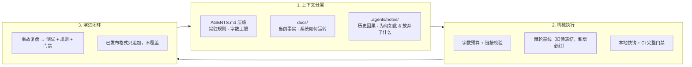

<div align="center">

# Sustainable Engineering

**让 AI 参与开发的工程长期演进、不滑向“屎山”**

面向 **Claude Code · Codex · Antigravity** 与人类开发者的工程治理 Agent Skill<br/>
源自 [DeepSeek Harness](https://github.com/deepseek-ai/deepseek-harness) 实战体系 · 技术栈无关 · 零依赖脚本

[](https://github.com/hewenyu/dsh-osc/actions/workflows/verify.yml)
[](LICENSE)
[](skills/sustainable-engineering/scripts/)
[](skills/sustainable-engineering/scripts/)
[](skills/sustainable-engineering/SKILL.md)

**简体中文** · [English](README.en.md)

[快速开始](#-30-秒上手) · [解决什么痛点](#-为什么-vibe-coding-项目会崩) · [真实运行效果](#-它不只是-prompt开箱即用的机械门禁) · [核心机制](#-核心模型四层归属) · [渐进落地](#-渐进式落地不要第一天上全套) · [参与贡献](#-参与贡献)

</div>

---

## ⚡ 30 秒上手

### 1. 一行安装

```sh
npx skills add hewenyu/dsh-osc          # 安装到当前项目（推荐）
npx skills add hewenyu/dsh-osc -g       # 安装到用户全局
```

<details>
<summary>其他安装方式：Claude Code 插件市场 / Codex / Antigravity / 手动复制</summary>

**Claude Code 插件市场**

```text
/plugin marketplace add hewenyu/dsh-osc
/plugin install sustainable-engineering@dsh-osc
```

**Codex 与 Antigravity（手动克隆安装）**

```sh
DEST=~/.agents/skills             # Codex 用户全局；Antigravity 用 ~/.gemini/config/skills
( set -e; TMP=$(mktemp -d); trap 'rm -rf "$TMP"' EXIT
  git clone --depth 1 https://github.com/hewenyu/dsh-osc.git "$TMP"
  mkdir -p "$DEST"; cp -R "$TMP/skills/sustainable-engineering" "$DEST/" )
```

- **Codex**：用户全局 `~/.agents/skills/`，项目级 `.agents/skills/`（旧版 `~/.codex/skills/` 仅作兼容）。
- **Antigravity**：用户全局 `~/.gemini/config/skills/`（App / CLI `agy` / IDE 通用），项目级 `.agents/skills/`。
- **手动复制**：将 [skills/sustainable-engineering/](skills/sustainable-engineering/) 直接复制到任意 Agent 的 skills 目录即可。

</details>

### 2. 直接对你的 Agent 说

- **先体检**：“用 `sustainable-engineering` 审计一下这个仓库的健康度，告诉我从哪一级开始。”
- **15 分钟起步**：“按 `sustainable-engineering` 的 Day 1 给仓库搭好 `AGENTS.md` 和 `.agents/notes/`。”
- **安全做需求**：“按工作流 B 实现这个功能：……”
- **把事故变护栏**：“这个线上 bug 已修复，按工作流 D 写复盘并补上机械门禁。”

---

## 🔥 为什么 Vibe Coding 项目会崩？

代码越写越快，几个月后却没人敢改——根源不是模型不够强，而是**没有持久记忆、也没有机械护栏**：

| 常见崩坏现场 | 传统做法的死胡同 | 接入 Sustainable Engineering 后 |
|---|---|---|
| `AGENTS.md` 膨胀到 5,000 词，Agent 根本不遵守 | 越写越长，重点淹没 | 常驻文档强制**字数预算**，每条 1–3 行 + 链接 |
| 新会话反复重提 3 个月前已否决的方案（如改用 Redis） | 靠人脑一遍遍提醒 | `.agents/notes/` 强制记录**被放弃的方案**，动手前必查 |
| 老仓库已有 70 处 `as any` / 空 `catch`，新规则推不动 | 要么全量停工重构，要么彻底放弃 | **棘轮基线**冻结旧债，新增即失败，只减不增 |
| `docs/` 充斥“以前/计划 v2”与过期 API 表 | 文档很快失去信任 | **事实与因果分离**，目录由脚本生成并校验新鲜度 |
| 单元测试全绿，线上却因未等子进程退出损坏数据 | Mock 掉了真实边界 | **验证真实世界** + 事故复盘沉淀为永久门禁 |

> 坦诚边界：机械脚本只能守住可自动判定的不变量（预算、笔记格式、链接、棘轮防放宽）；架构边界与测试断言质量仍依赖人工评审与项目自有检查。

---

## 🛠 它不只是 Prompt：开箱即用的机械门禁

内置 **4 个零依赖 Node.js 18+ 脚本**，可直接从 Skill 目录运行或拷贝到 `scripts/governance/` 接入 CI：

```text
$ node scripts/governance/verify-doc-budgets.mjs --list
ok       277 / 600      46% AGENTS.md
ok      1406 / 1500     94% skills/sustainable-engineering/SKILL.md
OVER    2410 / 2000    121% docs/AGENTS.md   ← 超过上限，CI 直接打回

$ node scripts/governance/ratchet-baseline.mjs --base origin/main
ratchet-baseline failed: 1 new finding(s)
  [no-ts-any-cast] src/worker/shutdown.ts:42  const p = proc as any
  (legacy debt stays frozen; fix the new finding instead of growing the baseline)

$ node scripts/governance/verify-agent-notes.mjs --base origin/main
verify-agent-notes failed:
  .agents/notes/implemented/architecture/2026-11-23-job-queue.md: missing non-empty "## Alternatives considered"
```

| 脚本 | 守住什么 | 关键防绕过 |
|---|---|---|
| [`verify-doc-budgets.mjs`](skills/sustainable-engineering/scripts/verify-doc-budgets.mjs) | 文档字数上限（中日文逐字计数） | `--base` 拦截调高上限或删条目 |
| [`verify-agent-notes.mjs`](skills/sustainable-engineering/scripts/verify-agent-notes.mjs) | 路径、Status、非空章节、禁 `INDEX.md` | `--base` 冻结 `archived/` 与 `rejected/` |
| [`ratchet-baseline.mjs`](skills/sustainable-engineering/scripts/ratchet-baseline.mjs) | 冻结旧债，新增即失败，只减不增 | 多行正则、外部 `--findings`、`git mv`、空扫描报错、`--base` 防放宽 |
| [`verify-md-links.mjs`](skills/sustainable-engineering/scripts/verify-md-links.mjs) | 相对链接与 GitHub/CJK 锚点 | 多行链接、平衡括号、行内代码标题、空扫描报错 |

退出码统一：`0` 通过、`1` 违规、`2` 用法/配置错误（均支持 `--help` / `--version`）。

---

## 🧭 核心模型：四层归属

> **测试管当下，笔记管未来，复盘把每一次逃逸变成两者。**



| 归属层 | 放什么 | 绝不放什么 | 深入指南 |
|---|---|---|---|
| `AGENTS.md`（根与子树，`CLAUDE.md` 用 `@AGENTS.md` 引用） | 每会话必读规则，1–3 行 + 链接 | 故事、教程、重复摘抄 | [information-architecture.md](skills/sustainable-engineering/references/information-architecture.md) |
| `docs/` | 当前事实：架构图谱、防御习惯、操作手册、事故复盘 | 决策理由、计划、“以前/不再” | [defensive-habits.md](skills/sustainable-engineering/references/defensive-habits.md) · [evolution-and-incidents.md](skills/sustainable-engineering/references/evolution-and-incidents.md) |
| `.agents/notes/{lifecycle}/{class}/` | 非平凡决策的动机、权衡与被放弃方案 | 当下接口手册、全局 `INDEX.md` | [agent-notes.md](skills/sustainable-engineering/references/agent-notes.md) |
| 自动化检查（Hooks / Scripts / CI） | 凡出现两次以上的评审意见 | 没人跑的摆设检查 | [mechanical-enforcement.md](skills/sustainable-engineering/references/mechanical-enforcement.md) · [review-and-audit.md](skills/sustainable-engineering/references/review-and-audit.md) |

---

## 🪜 渐进式落地：不要第一天上全套

每一级都能独立产生价值，停在与项目规模匹配的一级即可（**遇到线上事故或活跃失血时，风险优先于阶梯，可随时拉前工作流 D 或单条棘轮**）：

| 阶段 | 投入 | 落地内容 |
|---|---|---|
| **Day 1** | 15 分钟 | 根 `AGENTS.md` + `CLAUDE.md`（`@AGENTS.md`）；建 `.agents/notes/`；写下最怕被 Agent 改掉的第 1 篇决策笔记 |
| **Week 1** | 1–2 小时 | 字数预算、笔记格式、链接检查接入 CI；每个检查故意造错验证一次红灯；补一页 `docs/architecture.md` |
| **团队成长** | 持续 | 重复 review 意见升格为门禁；用棘轮冻结老债；配 `CODEOWNERS`、本地 hook、防御习惯与事故复盘 |
| **规模化** | 持续 | 编号设计准则、生成式目录 + 新鲜度门禁、已发布格式与归档笔记只追加、接入语言 AST/Linter 棘轮 |

详见 [adoption-ladder.md](skills/sustainable-engineering/references/adoption-ladder.md) 与 [13 份开箱模板](skills/sustainable-engineering/templates/)。

<details>
<summary>查看完整仓库结构与独立脚本运行示例</summary>

```text
skills/sustainable-engineering/
├── SKILL.md            # Skill 主入口（1,406 词）：规则、工作流 A–D、按需索引
├── references/         # 7 篇无重叠专题文档，按需加载
├── templates/          # 13 份起步模板（AGENTS.md、笔记、复盘、CODEOWNERS、CI、lefthook 等）
└── scripts/            # 4 个零依赖 Node.js 18+ 门禁脚本
tests/scripts.test.mjs  # 128 项正/反向对照测试（Node 18 & 22 CI 验证）
.agents/notes/          # 本仓库自身的设计决策记录（Dogfooding）
```

脱离 Agent 直接运行脚本：

```sh
S=~/.agents/skills/sustainable-engineering/scripts   # Claude 插件安装在 ~/.claude/plugins/cache/ 下
node "$S/verify-agent-notes.mjs" --root .
node "$S/verify-doc-budgets.mjs" --root . --list
node "$S/verify-md-links.mjs" --root .
node "$S/ratchet-baseline.mjs" --root . --help
```

</details>

---

## 🧪 自举与验证

本仓库按自身规则维护（[AGENTS.md](AGENTS.md)、[.agents/notes/](.agents/notes/README.md)）：

- **128 项正/反向对照测试**（含真实 CI 模板执行，覆盖 Node 18 / 22+）
- **Claude Code / Codex / Antigravity 三方对抗评审通过**（验证跨会话记忆、棘轮防放宽与多端安装路径）

---

## 🤝 参与贡献

欢迎提交 Issue 与 PR！改动前请阅读 [AGENTS.md](AGENTS.md)，提交前在本地运行：

```sh
node --test tests/*.test.mjs
node skills/sustainable-engineering/scripts/verify-doc-budgets.mjs --manifest .github/doc-budgets.manifest.json
node skills/sustainable-engineering/scripts/verify-md-links.mjs --exclude 'skills/*/templates/**'
node skills/sustainable-engineering/scripts/verify-agent-notes.mjs
```

---

## 🙏 致谢与出处

- [**DeepSeek Harness**](https://github.com/deepseek-ai/deepseek-harness)：`AGENTS.md` 分层、One Home Per Fact、Agent Notes 生命周期、字数预算、棘轮基线、防御习惯与测试原则均提炼自其公开源码，并抽象为与技术栈无关的通用体系。
- **Linux.do 社区文章**[《从 DSH 源码看 DeepSeek Harness 团队是如何维护项目的》](https://linux.do/t/topic/2904342)：提供了“事实与因果分离”“测试管当下，笔记管未来”的核心分析框架。

## 📄 License

[MIT](LICENSE)
